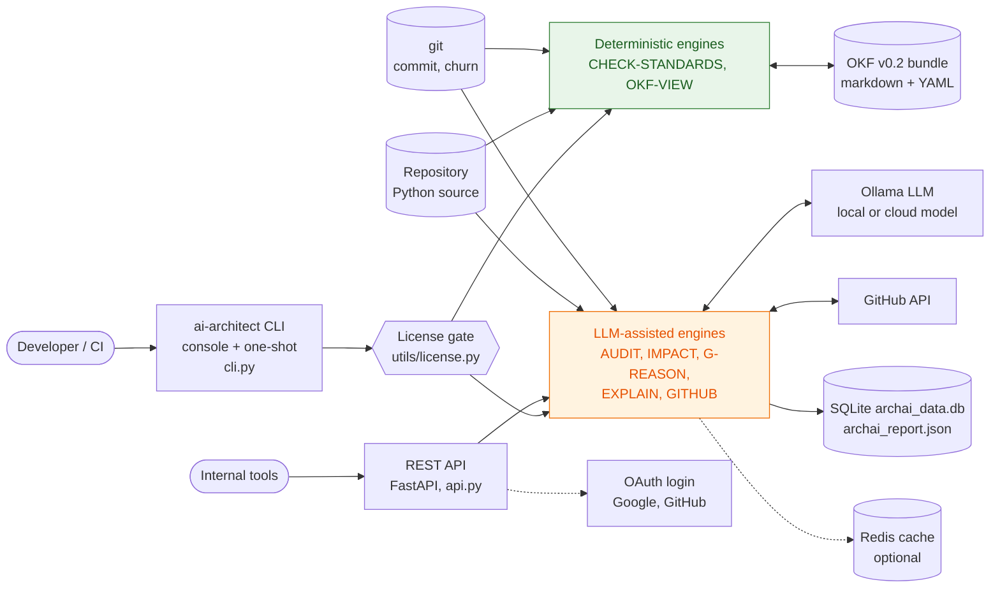
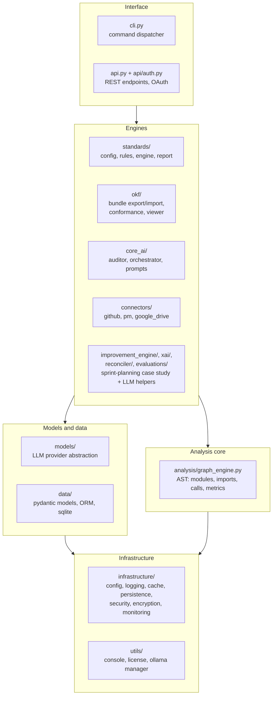
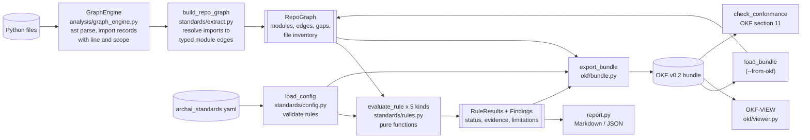
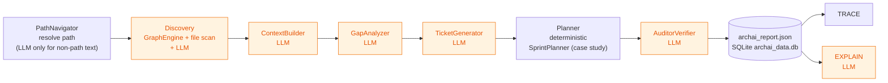
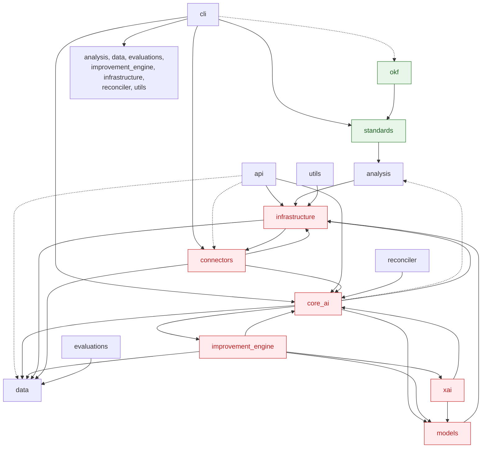
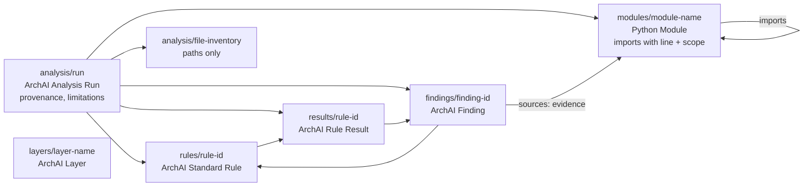

# ArchAI: Codebase Doctor with an OKF-Backed Standards Checker

**Understand the code. Check the rules. Prove the findings.**

ArchAI analyzes a Python repository, checks it against engineering standards you
configure explicitly, and cites the source evidence for every finding (file and,
where it applies, line). The repository knowledge, the rules and the findings can be exported as an
[Open Knowledge Format (OKF)](https://github.com/GoogleCloudPlatform/open-knowledge-format)
v0.2 bundle and re-checked from that bundle alone.

**Documentation:** [command reference](docs/cli/commands.md) ·
[standards & rules](docs/cli/check-standards.md) ·
[configuration & environment](docs/cli/configuration.md) ·
[recipes](docs/cli/examples.md). Build the site with `mkdocs serve`.

## Core principle: Receipts or Silence

- A finding is reported as a **verified violation** only when every fact behind
  it was extracted deterministically from source and is cited.
- When static analysis cannot settle a question, ArchAI says so
  (`POTENTIAL_RISK`, `INSUFFICIENT_GRAPH_EVIDENCE`) instead of guessing.
- ArchAI never claims your organization's standard was violated unless you
  supplied that standard. Built-in rules are labelled **ArchAI defaults**.
- `CHECK-STANDARDS` uses no LLM and no network.

---

## What ArchAI does today

| Command | What it does | How it decides |
|---|---|---|
| `CHECK-STANDARDS` | Checks configured standards; reports findings with evidence; exports/imports OKF | **Deterministic** (AST analysis, no LLM, no network) |
| `AUDIT` | Broad architectural audit producing work items | Dependency graph from AST, findings written by an **LLM** |
| `G-REASON` | Answers a question about the dependency graph | **LLM** over the extracted graph |
| `EXPLAIN` | Explains an item from a previous AUDIT report | **LLM** |
| `IMPACT` | Lists callers/importers of a symbol and rates risk | Name-based call trace (deterministic) plus an **LLM** risk verdict |
| `TRACE` | Shows the evidence recorded for an AUDIT ticket | Lookup of what the LLM recorded |
| `GITHUB AUDIT` / `ANALYZE` / `VALIDATE-LOCAL` | Clones or diffs a repository and runs AUDIT/IMPACT | As above; contacts GitHub |

LLM-backed commands use the provider in `archai_config.yaml` (Ollama by default;
the default model `glm-4.6:cloud` is a **cloud** model, so code summaries leave
your machine). Treat their output as assistance, not verified fact.

### What it does not do (yet)

- Analyze languages other than Python. Other source files are counted and
  reported as **not covered**, never treated as clean.
- See runtime wiring: dependency injection, plugin registries, reflection.
  Only static `import` statements and literal `importlib.import_module(...)` calls are facts.
- Measure test coverage. The required-tests rule checks file existence by
  naming convention only.
- Sprint planning and estimation as part of the default workflow. `PLAN`,
  `SIMULATE` and `RELEASE-CONFIDENCE` come from ArchAI's sprint-planning case
  study (WDP-TG and SRC-RS); switch them on with `ARCHAI_ENABLE_SPRINT_PLANNING=1`.

---

## Installation

Python 3.10+.

```bash
git clone https://github.com/Hami0095/ai-architecture.git
cd ai-architecture
python -m venv venv && source venv/bin/activate   # Windows: .\venv\Scripts\activate
pip install -e .
```

Ollama is needed only for the LLM-backed commands, not for `CHECK-STANDARDS`.

The `ai-architect` entry point requires a pilot license token
(`--license <TOKEN>`); for local development set `ARCHAI_DEV_MODE=1`.

## Quick start: check standards

```bash
# One-shot (exit code 0 = no verified violations, 1 = verified violations, 2 = usage/config error)
ai-architect CHECK-STANDARDS path/to/repo

# With an explicit configuration, machine-readable output and an OKF bundle
ai-architect CHECK-STANDARDS path/to/repo --config archai_standards.yaml \
    --json report.json --markdown report.md --okf-out knowledge-bundle

# Re-adjudicate from the OKF bundle only (no access to the source needed)
ai-architect CHECK-STANDARDS --from-okf knowledge-bundle --json
```

Inside the interactive console (`ai-architect`), the same command works:
`CHECK-STANDARDS . --verbose`.

Options: `--config FILE`, `--no-defaults`, `--json [FILE]` (stdout when no
file), `--markdown FILE`, `--okf-out DIR`, `--from-okf DIR`, `--verbose`.

The Markdown report answers, in order: what was checked, what was found, the
evidence for each finding, what could not be verified, and what to investigate next.

## Previewing an OKF bundle: OKF-VIEW

`OKF-VIEW` browses any OKF v0.2 bundle in the terminal, whether ArchAI wrote it or not.
Google's sample bundles in the OKF repository render too.

```bash
ai-architect CHECK-STANDARDS . --okf-out bundle --preview   # export, then show the overview

ai-architect OKF-VIEW bundle                    # overview: conformance, trust tiers, types; for ArchAI
                                                # bundles also provenance, rule outcomes, top findings
ai-architect OKF-VIEW bundle findings --status violation   # VIOLATION | RISK | NO-EVIDENCE
ai-architect OKF-VIEW bundle tree               # directory tree with concept types
ai-architect OKF-VIEW bundle list --type Metric # concepts, filtered by type
ai-architect OKF-VIEW bundle rules|results|modules|layers
ai-architect OKF-VIEW bundle F-2b20e2df65e7     # one concept (by id, title, or unique substring)
ai-architect OKF-VIEW bundle app.domain --raw   # ... with its full frontmatter
```

A concept page shows the title, type, trust tier (§5.3), lifecycle `status`,
`generated`, and freshness against `stale_after` (§5.5). It also shows the body
with every link resolved to a concept id (broken links are marked
`[missing]`), sources grouped by what they point to, and backlinks
("linked from", "imported by"). ArchAI findings add their status, rule and
verification method; Attested Computations show `runtime`, `parameters`,
`executor` and `attester` (§10). Output uses color on a terminal; pass
`--no-color` or set `NO_COLOR` to turn it off. Exit code 2 means the bundle or concept was not found.

## Configuring standards

Put `archai_standards.yaml` at the repository root (found automatically) or
pass `--config`. A complete annotated example is in
[`examples/archai_standards.example.yaml`](examples/archai_standards.example.yaml).

```yaml
version: 1
layers:
  domain: ["myapp.domain"]
  infrastructure: ["myapp.db", "myapp.adapters"]
rules:
  - id: domain-is-pure
    kind: layer_boundary
    layer: domain
    forbidden_layers: [infrastructure]
    rationale: The domain model should be testable without I/O.
```

**Patterns.** A plain dotted name (`myapp.domain`) matches that module and all
its submodules. Patterns containing `*`, `?` or `[` are matched with `fnmatch`
against the full dotted module name.

| Kind | Checks | Key settings |
|---|---|---|
| `forbidden_dependency` | Modules matching `from` must not import modules matching `to` | `from`, `to` |
| `layer_boundary` | A named layer must not depend on (`forbidden_layers`) / may only depend on (`allowed_layers`) other layers | `layer`, one of the two lists |
| `circular_dependency` | No import cycles; each cycle is reported with a concrete path and the import line for every step | `scope` (default all) |
| `coupling_threshold` | `fan_out` (internal modules imported) or `fan_in` (internal importers) must not exceed `max`; reports measured value and threshold | `metric`, `max`, `scope` |
| `required_tests` | Each module in scope has a test file at one of the conventional paths | `scope`, `test_paths` with `{leaf}` `{module}` `{module_path}` `{parent_path}` |

Each rule takes a stable `id`, and optional `description` and `rationale`.
Malformed configuration (unknown keys or kinds, undeclared layers, bad
thresholds, duplicate ids) is rejected with an explicit error and exit code 2.

**ArchAI defaults.** When no rules are configured, ArchAI evaluates one rule,
`archai.default.no-import-cycles`, and says so at the top of the report. It is a
common engineering heuristic, not your organization's standard. Control this
with `defaults: auto | true | false` in the config or `--no-defaults`.

## How findings are verified

Every finding carries: a stable ID (a hash of the rule and the facts, so it
survives reruns), the rule and its expected condition, the affected modules
and files, evidence references, the observed facts, the evaluation result,
limitations and a suggested next step.

| Status | Meaning |
|---|---|
| `VERIFIED_VIOLATION` | The rule is broken and every supporting fact is cited from source. |
| `POTENTIAL_RISK` | The facts match the rule's pattern, but whether it is a breach depends on something static analysis cannot settle, e.g. an import only under `if TYPE_CHECKING:`, a literal `importlib.import_module(...)`, a cycle closed only by a function-level import, or a missing conventional test file when another test imports the module. |
| `INSUFFICIENT_GRAPH_EVIDENCE` | Part of the scope could not be evaluated: files that fail to parse, patterns matching nothing, internal imports that resolve to no module, non-literal dynamic imports, overlapping layers, or no Python at all. Silence there is not compliance. |
| `PASS` | (Rule outcome only.) Nothing found **within the rule's declared scope**. It does not certify the architecture. |

`verification` on each finding states the method (`deterministic-static-analysis`),
`llm_assisted: false`, and `evidence_completeness` (`complete` or `partial`).
ArchAI does not produce numeric confidence scores for standards findings.

Line numbers come from Python's `ast` and point at the import statement.
Evidence about whole files (a module that needs a test, a missing test path,
a parse failure) has no line number rather than a guessed one.

## Architecture

ArchAI combines five architectural styles. The diagrams below are drawn from
the code; the package dependency graph in §5 was produced by ArchAI's own
graph engine. (GitHub renders these Mermaid diagrams; in VS Code use a
Mermaid-capable Markdown preview.)

| Style | Where | Why |
|---|---|---|
| Command interpreter | `cli.py`, `api.py` | One dispatcher behind the console, one-shot CLI and REST API |
| Layered | package structure | Interface → engines → analysis core → models/data → infrastructure |
| Pipes and filters | `CHECK-STANDARDS` | Deterministic stages, each a pure transformation of the previous output |
| Multi-agent pipeline | `AUDIT` | A fixed sequence of LLM agents sharing state through an orchestrator |
| Knowledge graph | OKF bundle | Facts, rules and findings as linked documents that outlive the run |

### 1. System context



Green parts never call an LLM or the network. Orange parts send repository
information to the configured model, which by default is a cloud model.

### 2. Layers



The layering is intended rather than enforced: §5 shows where the code
crosses it.

### 3. CHECK-STANDARDS: pipes and filters

Each stage is deterministic and takes only the previous stage's output.
Rules see the `RepoGraph`, never the files, so the same rules can run on a
graph rebuilt from an OKF bundle.



### 4. AUDIT: multi-agent pipeline

`Orchestrator.run_pipeline` (`core_ai/orchestrator.py`) runs the agents in
order. Each agent's output is validated into a pydantic model and appended to
a shared `AgentState`; a failed agent stops the run.



The other LLM-assisted commands are single steps: `IMPACT` runs
`GraphEngine.get_impact_scope` (name-based caller trace) and asks the LLM for
a risk verdict; `G-REASON` sends `get_graph_summary()` and your question to
the LLM; `GITHUB ANALYZE` combines `IMPACT` with the sprint-planning case-study engines.

### 5. Package dependencies, as measured by ArchAI

Generated from ArchAI's own import graph (tests and scripts excluded; an
arrow means "imports"; dashed arrows are function-level imports only).



**Red: a package-level cycle.** `core_ai`, `improvement_engine`, `xai`,
`models`, `infrastructure` and `connectors` can all reach each other through
module-level imports. The import that closes the loop is
`infrastructure/usage_tracker.py:6` importing `connectors.google_drive`: the
infrastructure layer depends on an integration. There is no cycle between
individual modules, which is why the `no-import-cycles` rule passes on this
repository; the cycle exists only between packages.

**Green:** the standards and OKF packages depend only downward (`okf` →
`standards` → `analysis`) and are outside the cycle.

This package view was computed by collapsing `RepoGraph` module edges to
their top-level package. It is not yet a CLI command; the module-level graph
behind it is in any exported bundle (`OKF-VIEW bundle modules`).

### 6. Knowledge representation: the OKF bundle

`--okf-out` writes the run as linked concepts. Arrows are markdown links
between concept files; evidence links use OKF `sources` with per-claim
footnotes.



The OKF layer is a portable representation, not a replacement for the graph
engine. Because rules evaluate a `RepoGraph` regardless of where it came from,
`--from-okf` re-runs adjudication using only the bundle; the test suite
asserts this reproduces the from-source results exactly.

### OKF bundle layout

```
index.md                    okf_version: "0.2" (the only frontmatter allowed in an index)
analysis/run.md             type: ArchAI Analysis Run   provenance, scope, limitations
analysis/file-inventory.md  type: ArchAI File Inventory paths only, no contents
modules/<module>.md         type: Python Module         imports with line and scope
layers/<layer>.md           type: ArchAI Layer
rules/<rule-id>.md          type: ArchAI Standard Rule  origin: user-config | archai-default
results/<rule-id>.md        type: ArchAI Rule Result
findings/<finding-id>.md    type: ArchAI Finding        evidence as OKF `sources` + footnotes
```

**OKF features used:** required `type`; `title`, `description`, `tags`;
`generated: {by, at}` with the `<producer>/<version>` actor convention;
`sources` with stable `id`s and per-claim footnote attribution (§5.1);
bundle-relative markdown links between concepts (§6.1); `index.md` files
per directory (§8); `okf_version` on the root index (§12). Typed ArchAI data
lives in `archai_*` extension keys, which §4.1 permits.

**Deliberately not used:** `verified` (extraction is not independent
confirmation, so every concept's trust tier is *unverified*), `status`,
`stale_after`, `resource` (no canonical URI exists for a local file), `log.md`,
and Attested Computations (§10). Mapping rules to Attested Computations would need an
executor/receipt/attester protocol that ArchAI does not implement.

**Conformance.** `check_conformance` implements the three conditions of
OKF v0.2 §11, and `CHECK-STANDARDS --okf-out` runs it on every bundle it writes. This is ArchAI's
reading of the spec; the OKF repository publishes no standalone validator.
The test suite can additionally cross-check bundles against the upstream
reference parser (`reference_agent/bundle/document.py`) when
`OKF_REFERENCE_SRC` points at a checkout of the OKF repository's `src/`.
Spec version verified: OKF v0.2 (`SPEC.md` at commit `ad30107`, 2026-08-21).

## Reproducing an analysis

Each JSON report and bundle records: repository name, git commit and whether
the working tree was dirty, ArchAI version, a hash of the deterministic
engine's source (`engine_sha256`), the config file name and SHA-256, the
timestamp, duration, Python version, `fact_source` (`source-extraction` or
`okf-bundle`), and `llm_used` / `network_used` (both `false`). The git remote
URL is deliberately not recorded, because clone URLs can embed tokens.

Set `SOURCE_DATE_EPOCH` to fix the timestamp; with it set, two runs on the same
commit and config produce byte-identical bundles apart from `duration_ms`.

```bash
git -C path/to/repo checkout <commit>
SOURCE_DATE_EPOCH=1790000000 ARCHAI_DEV_MODE=1 \
  ai-architect CHECK-STANDARDS path/to/repo --config standards.yaml --json run.json --okf-out bundle
```

### Comparing with and without the OKF layer

The same rules can be evaluated with facts read directly from source
(condition A) or facts read back from the OKF bundle (condition B,
`--from-okf`). Today the two are equivalent by construction. That shows the
bundle is lossless for these rules; it does **not** show that OKF improves
accuracy. No such comparison has been run yet.

## Use ArchAI from Claude Code and Codex

ArchAI's deterministic agents are available to AI coding agents through an MCP
server and an agent skill (see [docs/cli/ai-agents.md](docs/cli/ai-agents.md)):

```bash
pip install -e ".[agents]"
ai-architect AGENT-SETUP --install-skill --register   # needs ARCHAI_LICENSE or ARCHAI_DEV_MODE
```

The agent can then check standards, trace import paths, list what depends on a
module, and map a branch's changes to affected modules, all with file:line
receipts and without any LLM call on ArchAI's side.

## Running tests

```bash
python -m pytest tests/
```

- `tests/test_standards.py`: each rule against synthetic repositories with known
  outcomes, including look-alike code that must not trigger findings, syntax
  errors, unsupported languages, malformed configs, determinism, and a check
  that every cited line really holds the cited statement.
- `tests/test_okf.py`: bundle conformance, round trip, adjudication from the
  bundle, byte reproducibility, and the optional reference-parser cross-check.
- `tests/test_check_standards_cli.py`: the command through the console dispatcher.
- `tests/test_agents.py` calls a real LLM and is skipped unless
  `ARCHAI_RUN_LLM_TESTS=1`.

## Known limitations

- Python only; files must parse under the Python version running ArchAI.
- Static imports only; implicit parent-package imports are not modelled as edges.
- `fan_in`/`fan_out` count distinct internal modules, not symbols or call sites.
- Excluded paths are removed from the analyzed system entirely.
- Required-tests checks file existence by convention, not coverage or quality.
- `AUDIT`, `G-REASON`, `EXPLAIN` and the risk verdict in `IMPACT` are LLM output
  and are not covered by the guarantees above. The AUDIT pipeline still builds
  a sprint plan internally, and `GITHUB ANALYZE` still includes a sprint confidence estimate.
- `ArchValidator` (`analysis/validator.py`) is an older, unwired rule set that infers
  layers from path substrings; `CHECK-STANDARDS` does not use it.

## Acknowledgements

Open Knowledge Format © Google LLC, Apache-2.0:
<https://github.com/GoogleCloudPlatform/open-knowledge-format>. ArchAI is not
affiliated with or endorsed by Google.

## License

GNU Affero General Public License v3.0 (AGPL-3.0). See [LICENSE](LICENSE).
