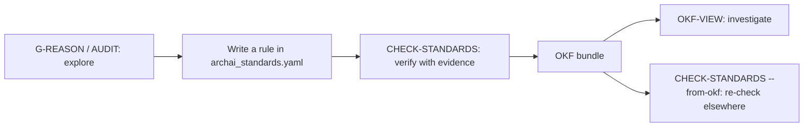

# Tutorial: Chaining Workflows

Commands are designed to feed one another: deterministic checks produce
facts and an OKF bundle; the bundle can be browsed, shared and re-checked;
LLM-assisted commands help you decide which rules to write.



## Explore, then verify

```bash
ai-architect G-REASON . "Which modules couple the API to the database?"
```

The answer is LLM output. Encode the question as a rule and get a verified answer:

```yaml
rules:
  - id: api-not-db
    kind: forbidden_dependency
    from: ["myapp.api"]
    to: ["myapp.db"]
```

```bash
ai-architect CHECK-STANDARDS .
```

## Check, export, investigate

```bash
ai-architect CHECK-STANDARDS . --json report.json --okf-out ../bundle
ai-architect OKF-VIEW ../bundle findings --status violation
ai-architect OKF-VIEW ../bundle F-2b20e2df65e7
```

## Script it

`CHECK-STANDARDS` exits `0` (no verified violations), `1` (violations) or
`2` (configuration or usage error):

```bash
#!/usr/bin/env bash
set -u
ai-architect CHECK-STANDARDS . --json report.json --okf-out bundle
case $? in
  0) echo "Standards met." ;;
  1) echo "Verified violations:"; ai-architect OKF-VIEW bundle findings --status violation --no-color; exit 1 ;;
  *) echo "Check could not run; see the output above."; exit 2 ;;
esac
```

## Re-check somewhere else

A bundle carries the graph and the rules, so a reviewer can re-run the check
without the source, or apply their own rules:

```bash
ai-architect CHECK-STANDARDS --from-okf bundle
ai-architect CHECK-STANDARDS --from-okf bundle --config reviewer-rules.yaml
```

More in [Recipes](../cli/examples.md).
