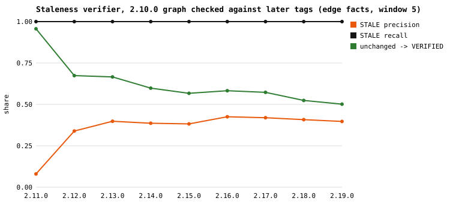
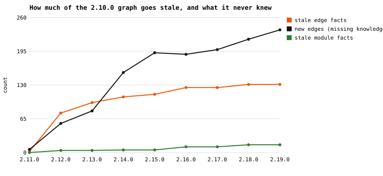

# Phase 1: ground truth and staleness detection (no LLM)

Run 2026-10-11T00:15:31Z · ArchAI 0.2.1-pilot (engine `e5c6c1839537b7d8`, commit `7106738d7d19`) · Python 3.13.9 · LLM used: no.

Reproduce: `python experiments/scrapy_staleness/phase1.py` (see README.md).

> **Change log (pre-registration).** After the first Phase 1 results and **before any LLM run**, the study added a second ArchAI condition, **D-reanchored**, next to the pre-registered **D-strict**. Reason: Phase 1 showed that strict receipts go stale for many dependencies that still exist (import lines that moved or gained or lost names), so D-strict alone would mix the cost of receipt churn with the benefit of catching real change. Re-anchoring rule, fixed before any LLM run: a STALE edge fact becomes VERIFIED only if the same source file (same path) still contains an import in the same scope class (module, function, type_checking or dynamic) that resolves to the same target; the new file:line is recorded. Also added before any LLM run: per-file coverage labels (COMPLETE / POSSIBLY_INCOMPLETE), an independent ground truth (grimp), a git-diff-restricted verification measurement, and ArchAI respecting .gitignore (no effect on these graphs: verified byte-identical).

## 1. Graphs per tag

Only the `scrapy/` package of each tag is analyzed (`git archive <tag> scrapy`). Edges are unique (source, target) pairs of `scrapy.*` modules linked by a **module-scope** import; the stored graphs also keep function-level, type-checking and dynamic imports.

| Tag | Commit | Modules | Module-scope edges | Import records (all scopes) | Parse failures | Build (s) |
|---|---|---|---|---|---|---|
| 2.10.0 | `88327c7c58` | 170 | 530 | 555 | 0 | 0.61 |
| 2.11.0 | `f2fb4760d2` | 171 | 534 | 565 | 0 | 0.65 |
| 2.12.0 | `b1f9e56693` | 170 | 510 | 733 | 0 | 1.99 |
| 2.13.0 | `82a3245158` | 172 | 514 | 756 | 0 | 0.98 |
| 2.14.0 | `3ac1192f35` | 174 | 577 | 812 | 0 | 1.16 |
| 2.15.0 | `47e25fbbb5` | 178 | 610 | 852 | 0 | 1.19 |
| 2.16.0 | `abe9c63841` | 174 | 594 | 828 | 0 | 1.13 |
| 2.17.0 | `feb692f552` | 174 | 603 | 839 | 0 | 1.18 |
| 2.18.0 | `2216063c06` | 176 | 617 | 860 | 0 | 1.24 |
| 2.19.0 | `8026deeaac` | 179 | 635 | 883 | 0 | 1.22 |

**Reproduction check** (2.10.0 → 2.19.0): 170 → 179 modules, 530 → 635 edges; modules added 24, removed 15 (of which 3 detected as moves); edges added 236, removed 131. These match the numbers given in the study prompt.

## 1b. Independent ground truth (grimp)

[grimp](https://github.com/seddonym/grimp) 3.17 builds the import graph with its own Rust parser and shares no code with ArchAI. Each tag was built in a fresh process with no cache. grimp does not record import scope, so the module-scope split of the ground truth was checked separately: a stdlib-only `ast` pass (written independently of ArchAI's scope logic) classifies each of grimp's import line numbers as module-level or inside a function / TYPE_CHECKING block.

| Tag | Comparison | ArchAI pairs | grimp pairs | Agree | Jaccard | Only grimp | Only ArchAI |
|---|---|---|---|---|---|---|---|
| 2.10.0 | runtime (module + function) | 537 | 537 | 537 | 1.000 | 0 | 0 |
| 2.10.0 | all static (+ type_checking) | 550 | 550 | 550 | 1.000 | 0 | 0 |
| 2.10.0 | **module-scope ground truth** (grimp lines + independent scope check) | 530 | 530 | 530 | 1.000 | 0 | 0 |
| 2.16.0 | runtime (module + function) | 604 | 604 | 604 | 1.000 | 0 | 0 |
| 2.16.0 | all static (+ type_checking) | 819 | 819 | 819 | 1.000 | 0 | 0 |
| 2.16.0 | **module-scope ground truth** (grimp lines + independent scope check) | 594 | 594 | 594 | 1.000 | 0 | 0 |
| 2.19.0 | runtime (module + function) | 646 | 646 | 646 | 1.000 | 0 | 0 |
| 2.19.0 | all static (+ type_checking) | 871 | 871 | 871 | 1.000 | 0 | 0 |
| 2.19.0 | **module-scope ground truth** (grimp lines + independent scope check) | 635 | 635 | 635 | 1.000 | 0 | 0 |

**Disagreement categories.**

- Edges: **none**. The two extractors agree on every edge, in both comparisons, at all three tags.
- Modules: ArchAI has `scrapy.templates.project.module`, `scrapy.templates.project.module.spiders` modules grimp lacks (2.10.0: 170 vs 168, 2.16.0: 174 vs 172, 2.19.0: 179 vs 177). These are project-template files under `scrapy/templates/project/`, a directory tree without `__init__.py` files. ArchAI maps every `.py` path to a module name (namespace-package semantics); grimp only follows regular packages. Neither module imports or is imported by anything, so no edge or answer depends on them.

Agreement with an independent extractor rules out ArchAI-specific extraction bugs for these graphs. Because the verifier still shares resolution code with ArchAI's graph builder, its scores below measure consistency with a ground truth that grimp has confirmed edge by edge.

## 2. Drift relative to 2.10.0

| Checked at | Releases | Commits | Days | Modules + | Modules − | Moved | Edges + | Edges − | Edges kept |
|---|---|---|---|---|---|---|---|---|---|
| 2.11.0 | 1 | 124 | 44 | 1 | 0 | 0 | 6 | 2 | 528 |
| 2.12.0 | 2 | 624 | 471 | 4 | 4 | 0 | 56 | 76 | 454 |
| 2.13.0 | 3 | 789 | 642 | 6 | 4 | 0 | 80 | 96 | 434 |
| 2.14.0 | 4 | 974 | 884 | 8 | 4 | 1 | 154 | 107 | 423 |
| 2.15.0 | 5 | 1068 | 978 | 12 | 4 | 1 | 192 | 112 | 418 |
| 2.16.0 | 6 | 1121 | 1018 | 14 | 10 | 1 | 189 | 125 | 405 |
| 2.17.0 | 7 | 1202 | 1067 | 15 | 11 | 0 | 198 | 125 | 405 |
| 2.18.0 | 8 | 1392 | 1112 | 18 | 12 | 3 | 218 | 131 | 399 |
| 2.19.0 | 9 | 1460 | 1132 | 21 | 12 | 3 | 236 | 131 | 399 |

Moves detected by git between 2.10.0 and 2.19.0: `scrapy.core.http2` → `scrapy.core._http2` (100%), `scrapy.core.http2.protocol` → `scrapy.core._http2.protocol` (75%), `scrapy.core.http2.stream` → `scrapy.core._http2.stream` (70%).

The full matrix for all 55 ordered pairs is in `results/phase1/drift_matrix.json`.

## 3. Staleness verifier vs ground truth

`ai_architect/standards/staleness.py` labels every fact of an old graph against a newer checkout (window: cited line ±5). Ground truth: an edge fact is stale if its (source, target) pair is no longer a module-scope edge at the checked tag; a module fact is stale if the module name no longer exists (moves count as stale).

### Edge facts (2.10.0 graph)

| Checked at | Facts | Truly stale | Labelled STALE | STALE precision | STALE recall | Unchanged → VERIFIED | False VERIFIED | UNVERIFIABLE |
|---|---|---|---|---|---|---|---|---|
| 2.11.0 | 530 | 2 | 25 | 8.0% | 100.0% | 95.6% | 0 | 0 |
| 2.12.0 | 530 | 76 | 224 | 33.9% | 100.0% | 67.4% | 0 | 0 |
| 2.13.0 | 530 | 96 | 241 | 39.8% | 100.0% | 66.6% | 0 | 0 |
| 2.14.0 | 530 | 107 | 277 | 38.6% | 100.0% | 59.8% | 0 | 0 |
| 2.15.0 | 530 | 112 | 293 | 38.2% | 100.0% | 56.7% | 0 | 0 |
| 2.16.0 | 530 | 125 | 294 | 42.5% | 100.0% | 58.3% | 0 | 0 |
| 2.17.0 | 530 | 125 | 298 | 41.9% | 100.0% | 57.3% | 0 | 0 |
| 2.18.0 | 530 | 131 | 321 | 40.8% | 100.0% | 52.4% | 0 | 0 |
| 2.19.0 | 530 | 131 | 330 | 39.7% | 100.0% | 50.1% | 0 | 0 |

### Module facts (2.10.0 graph)

| Checked at | Facts | Truly stale | STALE precision | STALE recall | Unchanged → VERIFIED | False VERIFIED |
|---|---|---|---|---|---|---|
| 2.11.0 | 170 | 0 | n/a | n/a | 100.0% | 0 |
| 2.12.0 | 170 | 4 | 100.0% | 100.0% | 100.0% | 0 |
| 2.13.0 | 170 | 4 | 100.0% | 100.0% | 100.0% | 0 |
| 2.14.0 | 170 | 5 | 100.0% | 100.0% | 100.0% | 0 |
| 2.15.0 | 170 | 5 | 100.0% | 100.0% | 100.0% | 0 |
| 2.16.0 | 170 | 11 | 100.0% | 100.0% | 100.0% | 0 |
| 2.17.0 | 170 | 11 | 100.0% | 100.0% | 100.0% | 0 |
| 2.18.0 | 170 | 15 | 100.0% | 100.0% | 100.0% | 0 |
| 2.19.0 | 170 | 15 | 100.0% | 100.0% | 100.0% | 0 |

**Why unchanged edges were labelled STALE** (false positives, summed over the 9 targets): import statement no longer present: 720; statement no longer within 5 lines: 678.

In every one of these cases the dependency still exists but the receipt no longer matches: the cited statement's text changed, or it moved further than the window. How the 'no longer present' statements changed:

| Checked at | Names added | Names removed | Names replaced | Rewritten in another form |
|---|---|---|---|---|
| 2.11.0 | 5 | 0 | 0 | 0 |
| 2.12.0 | 49 | 7 | 12 | 0 |
| 2.13.0 | 48 | 6 | 15 | 0 |
| 2.14.0 | 51 | 9 | 25 | 0 |
| 2.15.0 | 56 | 9 | 32 | 0 |
| 2.16.0 | 52 | 11 | 33 | 0 |
| 2.17.0 | 52 | 11 | 32 | 0 |
| 2.18.0 | 56 | 11 | 34 | 0 |
| 2.19.0 | 57 | 12 | 35 | 0 |

**All 45 pairs (every older graph against every newer tag):** false VERIFIED labels in total: 0. Edge STALE precision ranges 8.0%–65.3%, recall 100.0%–100.0%. Per-pair numbers: `results/phase1/verifier_evaluation.json`.

### Window sensitivity (secondary analysis)

The 5-line window was fixed before the run. Other windows, 2.10.0 graph, edge facts:

| Checked at | w=0: precision / recall / unchanged→VERIFIED | w=5: precision / recall / unchanged→VERIFIED | w=20: precision / recall / unchanged→VERIFIED | w=whole-file: precision / recall / unchanged→VERIFIED |
|---|---|---|---|---|
| 2.11.0 | 2.0% / 100.0% / 81.8% | 8.0% / 100.0% / 95.6% | 28.6% / 100.0% / 99.1% | 28.6% / 100.0% / 99.1% |
| 2.12.0 | 15.2% / 100.0% / 6.8% | 33.9% / 100.0% / 67.4% | 52.4% / 100.0% / 84.8% | 52.8% / 100.0% / 85.0% |
| 2.13.0 | 19.3% / 100.0% / 7.4% | 39.8% / 100.0% / 66.6% | 56.8% / 100.0% / 83.2% | 58.2% / 100.0% / 84.1% |
| 2.14.0 | 21.4% / 100.0% / 6.9% | 38.6% / 100.0% / 59.8% | 54.3% / 100.0% / 78.7% | 55.4% / 100.0% / 79.7% |
| 2.15.0 | 22.2% / 100.0% / 6.2% | 38.2% / 100.0% / 56.7% | 52.1% / 100.0% / 75.4% | 53.3% / 100.0% / 76.6% |
| 2.16.0 | 24.5% / 100.0% / 4.9% | 42.5% / 100.0% / 58.3% | 55.1% / 100.0% / 74.8% | 56.3% / 100.0% / 76.0% |
| 2.17.0 | 24.6% / 100.0% / 5.4% | 41.9% / 100.0% / 57.3% | 55.3% / 100.0% / 75.1% | 56.6% / 100.0% / 76.3% |
| 2.18.0 | 25.7% / 100.0% / 5.0% | 40.8% / 100.0% / 52.4% | 55.0% / 100.0% / 73.2% | 56.2% / 100.0% / 74.4% |
| 2.19.0 | 25.6% / 100.0% / 4.8% | 39.7% / 100.0% / 50.1% | 54.1% / 100.0% / 72.2% | 55.3% / 100.0% / 73.4% |

### D-strict vs D-reanchored (edge facts, 2.10.0 graph)

| Checked at | Re-anchored | Strict: STALE precision / unchanged→VERIFIED | Re-anchored: STALE precision / recall / unchanged→VERIFIED | False VERIFIED (strict / re-anchored) |
|---|---|---|---|---|
| 2.11.0 | 23 | 8.0% / 95.6% | 100.0% / 100.0% / 100.0% | 0 / 0 |
| 2.12.0 | 148 | 33.9% / 67.4% | 100.0% / 100.0% / 100.0% | 0 / 0 |
| 2.13.0 | 145 | 39.8% / 66.6% | 100.0% / 100.0% / 100.0% | 0 / 0 |
| 2.14.0 | 170 | 38.6% / 59.8% | 100.0% / 100.0% / 100.0% | 0 / 0 |
| 2.15.0 | 181 | 38.2% / 56.7% | 100.0% / 100.0% / 100.0% | 0 / 0 |
| 2.16.0 | 169 | 42.5% / 58.3% | 100.0% / 100.0% / 100.0% | 0 / 0 |
| 2.17.0 | 173 | 41.9% / 57.3% | 100.0% / 100.0% / 100.0% | 0 / 0 |
| 2.18.0 | 190 | 40.8% / 52.4% | 100.0% / 100.0% / 100.0% | 0 / 0 |
| 2.19.0 | 199 | 39.7% / 50.1% | 100.0% / 100.0% / 100.0% | 0 / 0 |

Re-anchored counts for every pair (row = graph built at, column = checked at); false VERIFIED labels across all 45 pairs after re-anchoring: **0**.

| Built at \ checked at | 2.11.0 | 2.12.0 | 2.13.0 | 2.14.0 | 2.15.0 | 2.16.0 | 2.17.0 | 2.18.0 | 2.19.0 |
|---|---|---|---|---|---|---|---|---|---|
| 2.10.0 | 23 | 148 | 145 | 170 | 181 | 169 | 173 | 190 | 199 |
| 2.11.0 |  | 161 | 157 | 173 | 180 | 172 | 176 | 192 | 201 |
| 2.12.0 |  |  | 20 | 55 | 74 | 75 | 76 | 85 | 87 |
| 2.13.0 |  |  |  | 44 | 69 | 71 | 70 | 78 | 80 |
| 2.14.0 |  |  |  |  | 33 | 42 | 44 | 64 | 66 |
| 2.15.0 |  |  |  |  |  | 17 | 24 | 55 | 57 |
| 2.16.0 |  |  |  |  |  |  | 13 | 51 | 53 |
| 2.17.0 |  |  |  |  |  |  |  | 46 | 48 |
| 2.18.0 |  |  |  |  |  |  |  |  | 2 |

### Coverage labels and missing knowledge

Each cited file is COMPLETE if its content hash is unchanged since the graph was built, otherwise POSSIBLY_INCOMPLETE. The check: for every edge that is new at the later tag, is its source file flagged?

| Checked at | Files COMPLETE / POSSIBLY_INCOMPLETE | New edges | Source file POSSIBLY_INCOMPLETE | Source file COMPLETE | Source module new (not in old graph) |
|---|---|---|---|---|---|
| 2.11.0 | 123 / 47 | 6 | 3 | 0 | 3 |
| 2.12.0 | 16 / 154 | 56 | 46 | 0 | 10 |
| 2.13.0 | 12 / 158 | 80 | 68 | 0 | 12 |
| 2.14.0 | 11 / 159 | 154 | 135 | 0 | 19 |
| 2.15.0 | 9 / 161 | 192 | 160 | 0 | 32 |
| 2.16.0 | 9 / 161 | 189 | 152 | 0 | 37 |
| 2.17.0 | 8 / 162 | 198 | 160 | 0 | 38 |
| 2.18.0 | 7 / 163 | 218 | 167 | 0 | 51 |
| 2.19.0 | 7 / 163 | 236 | 176 | 0 | 60 |

No new edge appeared in a file labelled COMPLETE: every missing fact sits in a file flagged POSSIBLY_INCOMPLETE, or in a module the old graph did not have.

### Git-diff-restricted verification

Variant that re-reads only files git reports changed between the tags (`git diff --name-only --no-renames`) and carries facts in all other files over as VERIFIED without re-reading them. Measured, not used in any condition.

| Checked at | Files changed (git) | Label differences vs full verify | STALE recall | False VERIFIED |
|---|---|---|---|---|
| 2.11.0 | 49 | 0 | 100.0% | 0 |
| 2.12.0 | 161 | 0 | 100.0% | 0 |
| 2.13.0 | 168 | 0 | 100.0% | 0 |
| 2.14.0 | 172 | 0 | 100.0% | 0 |
| 2.15.0 | 178 | 0 | 100.0% | 0 |
| 2.16.0 | 180 | 0 | 100.0% | 0 |
| 2.17.0 | 183 | 0 | 100.0% | 0 |
| 2.18.0 | 190 | 0 | 100.0% | 0 |
| 2.19.0 | 193 | 0 | 100.0% | 0 |

## 4. Verify vs rebuild time

Median of 3 runs, 2.10.0 graph checked against each tag. Full verify reads only the files the old facts cite; the git-restricted time includes the `git diff` call; rebuild parses the whole package.

| Checked at | Strict verify (s) | Re-anchor + coverage (s) | Git-restricted (s) | Rebuild (s) | Strict / rebuild |
|---|---|---|---|---|---|
| 2.11.0 | 0.450 | 0.411 | 0.235 | 0.786 | 0.57 |
| 2.12.0 | 0.459 | 0.503 | 0.492 | 0.855 | 0.54 |
| 2.13.0 | 0.484 | 0.492 | 0.485 | 0.943 | 0.51 |
| 2.14.0 | 0.474 | 0.481 | 0.491 | 0.906 | 0.52 |
| 2.15.0 | 0.539 | 0.527 | 0.670 | 1.012 | 0.53 |
| 2.16.0 | 0.555 | 0.626 | 0.853 | 1.134 | 0.49 |
| 2.17.0 | 0.552 | 0.574 | 0.655 | 1.018 | 0.54 |
| 2.18.0 | 0.511 | 0.492 | 0.549 | 1.131 | 0.45 |
| 2.19.0 | 0.571 | 0.522 | 0.558 | 1.168 | 0.49 |

## 5. Missing knowledge (not a staleness error)

Facts that exist at the later tag but not in the 2.10.0 graph. The verifier cannot see these, by design: it can only re-check what the old graph claims.

| Checked at | New modules | New edges | New edges as share of current edges |
|---|---|---|---|
| 2.11.0 | 1 | 6 | 1.1% |
| 2.12.0 | 4 | 56 | 11.0% |
| 2.13.0 | 6 | 80 | 15.6% |
| 2.14.0 | 9 | 154 | 26.7% |
| 2.15.0 | 13 | 192 | 31.5% |
| 2.16.0 | 15 | 189 | 31.8% |
| 2.17.0 | 15 | 198 | 32.8% |
| 2.18.0 | 21 | 218 | 35.3% |
| 2.19.0 | 24 | 236 | 37.2% |

## 6. Threats to validity

- One project, Python only, import-level structure only.
- The verifier and ArchAI's graph builder share resolution code (`resolve_import_targets`), so verifier scores measure consistency with the ArchAI ground truth. That ground truth was confirmed edge by edge by an independent extractor (grimp, section 1b) at three of the ten tags; the other seven tags rely on ArchAI alone.
- The git-diff-restricted variant trusts git's change list instead of re-reading files; it is reported as a measurement only and is not used in any Phase 2 condition.
- An edge fact counts as unchanged when its (source, target) pair survives, even if the import statement was rewritten. Such rewrites are counted as verifier false positives above.
- Moves are detected by git rename heuristics (50% similarity) and are reported, but scored as stale.
- Timings are wall-clock on one machine and include Python start-up effects inside the process; they are comparable to each other, not absolute.
- The Python grammar used to parse is the running interpreter's (see run metadata).
