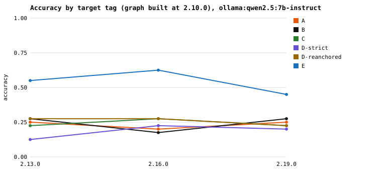
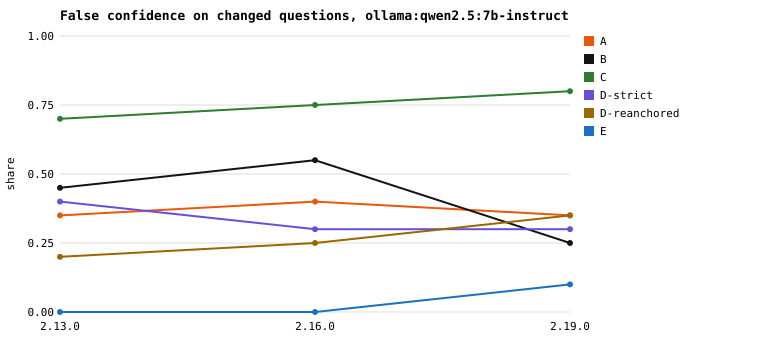
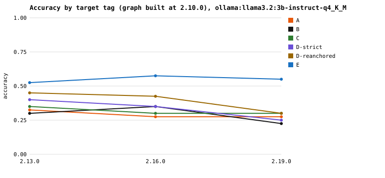
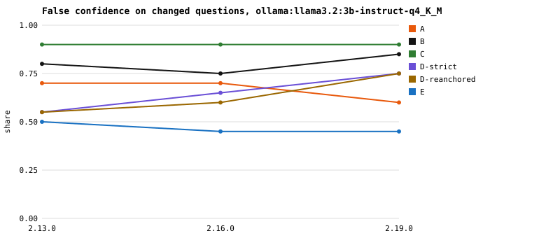

# Phase 2: does the trust layer change LLM answers?

Subject: Scrapy, graph built at 2.10.0, questions about 2.13.0, 2.16.0, 2.19.0. Ground truth comes only from the per-tag import graphs (Phase 1, confirmed edge by edge by grimp) and git rename detection. No model decides truth. All runs are local (Ollama); no code or prompt left the machine.

## Findings

All numbers below are measured in this study (tables in **Results**; subtype counts from `raw.jsonl`, re-scored by `phase2.py analyze`). 120 questions per model, 60 of them about facts that changed since 2.10.0.

1. **Verified evidence cut confident wrong answers on changed code, in both models.** False confidence on changed questions, C (plain 2.10.0 facts) → D-strict / D-reanchored:
   - qwen2.5 7B: 0.75 → 0.33 / 0.27, a difference of −0.42 and −0.48. Holm-corrected p < 0.001 for both.
   - llama3.2 3B: 0.90 → 0.65 / 0.63, a difference of −0.25 and −0.27. Holm-corrected p ≤ 0.001 for both.

   In 240 paired comparisons (60 changed questions × 2 D conditions × 2 models), no question went from a cautious answer under C to a confident wrong one under D.
2. **Overall accuracy did not improve significantly.** D vs C is −0.06 to +0.08, and no comparison survives Holm correction. The labels mostly turn wrong answers into abstentions, or into answers that happen to be right for the wrong reason (see 4). They do not supply the missing facts. The ceiling condition E (facts from the target tag) scores 0.54 (qwen) and 0.55 (llama).
3. **Re-anchoring removed the main cost of strict receipts without adding false confidence.**
   - Strict receipts mark imports STALE when their line moved or their name list changed, even though the import still exists. On the 9 unchanged "kept edge" Q1 questions:
     - D-strict made qwen say "no" 3 times and llama 6 times.
     - D-reanchored: qwen answered "yes" 9/9, llama 8/9.
   - D-reanchored vs D-strict, overall accuracy: +0.075 for qwen (9 questions fixed, 0 broken; Holm p = 0.023) and +0.058 for llama (8 fixed, 1 broken; Holm p = 0.27).
   - False confidence was equal or lower with re-anchoring in both models.
4. **The two models use the labels differently.**
   - qwen treats STALE as "don't know" and abstains. Its D abstention on unchanged questions is 0.50 / 0.45, against 0.23 for C.
   - llama rarely abstains (at most 0.12 on unchanged questions) and reads STALE as "false". That is right for removed imports (5/9 and 6/9 correct, against 0/9 in C) and wrong for imports that still exist.
   - The same labels, then, mean "abstain" to one model and "negate" to the other.
5. **The coverage label is not enough on its own.** On "which modules does X import?" (Q2) when X gained imports, both models in both D conditions listed only the recorded imports: 9/9 confident wrong answers each, the same as C. This happened although the file was labelled POSSIBLY_INCOMPLETE and the prompt said a missing fact is not evidence of absence.
   - On the yes/no form (Q1, new edges), qwen followed the rule (D-strict: 9/9 abstained).
   - llama answered 5/9 correctly and 3/9 wrongly.
6. **Plain facts were the most dangerous context.**
   - C had the highest false confidence of all six conditions in both models: 0.75 and 0.90.
   - That is higher than the AGENTS.md note (B: 0.42 and 0.80) and higher than no context at all (A: 0.37 and 0.67).
   - C vs B is significant for qwen (+0.33, Holm p = 0.001) but not for llama (+0.10, p = 1.0).

## Method

- **Questions** (`questions/<tag>.json`, seed 42): Q1 does X import Y; Q2 which scrapy modules does X import (set); Q3 does X exist / where did it move; Q4 is X in an import cycle (name one). 40 per tag, half `changed` and half `unchanged` relative to 2.10.0, split equally across templates and subtypes with spill-over where a subtype has too few candidates.
- **Conditions** (same system prompt and question; only the context differs): A none; B an AGENTS.md-style note written from the 2.10.0 graph (no version information); C the relevant 2.10.0 facts; D-strict and D-reanchored the same facts with file:line evidence, verifier labels (VERIFIED / STALE / UNVERIFIABLE), per-file coverage labels (COMPLETE / POSSIBLY_INCOMPLETE) and the rule to answer CANNOT_VERIFY instead of relying on STALE or UNVERIFIABLE facts; E the relevant facts from the target tag's graph (ceiling). Sample prompts: `questions/sample_prompts.md`.
- **Scoring:** the final `ANSWER:` line, parsed and scored deterministically against the target graph. Q4 is correct only if a named cycle exists in the target graph. Each (question, condition) is run 3 times at temperature 0, seed 42; the majority answer is scored (no majority = wrong). **False confidence** = a parseable, non-abstaining, wrong answer on a changed question.
- **Statistics:** bootstrap 95% CIs over questions (10000 resamples); exact McNemar tests for the comparisons fixed in `config.yaml` before any run, Holm-corrected per model.

Question sample (all three tags together):

| Template | Stratum | Subtype | Questions |
|---|---|---|---|
| Q1 | changed | new_edge | 9 |
| Q1 | changed | removed_edge | 9 |
| Q1 | unchanged | kept_edge | 9 |
| Q1 | unchanged | never_edge | 6 |
| Q2 | changed | gained_imports | 9 |
| Q2 | changed | lost_imports_only | 9 |
| Q2 | unchanged | same_imports | 15 |
| Q3 | changed | moved | 3 |
| Q3 | changed | new_module | 8 |
| Q3 | changed | removed | 7 |
| Q3 | unchanged | exists | 15 |
| Q4 | changed | left_cycle | 6 |
| Q4 | unchanged | never_in_cycle | 6 |
| Q4 | unchanged | still_in_cycle | 9 |

## Results

### ollama:qwen2.5:7b-instruct

qwen2 family, 7.6B parameters, Q4_K_M; digest `845dbda0ea48`, Ollama 0.40.2, ArchAI commit `3378430`. 120 questions × 6 conditions × 3 runs. Raw responses: `results/qwen2.5_7b-instruct/raw.jsonl`; analysis: `results/qwen2.5_7b-instruct/analysis.json`.

| Condition | Accuracy [95% CI] | False confidence, changed [95% CI] | Abstention (all / unchanged) | Q2 precision / recall | Unparseable | Median tokens in / out | Median latency (s) |
|---|---|---|---|---|---|---|---|
| A | 0.23 [0.16, 0.31] | 0.37 [0.25, 0.48] | 0.43 / 0.47 | 0.28 / 0.31 | 0 | 237.5 / 6 | 0.27 |
| B | 0.24 [0.17, 0.32] | 0.42 [0.30, 0.55] | 0.42 / 0.35 | 0.45 / 0.52 | 0 | 1525.5 / 5 | 0.25 |
| C | 0.24 [0.17, 0.32] | 0.75 [0.63, 0.85] | 0.21 / 0.23 | 0.75 / 0.86 | 13 | 283.5 / 7 | 0.30 |
| D-strict | 0.18 [0.12, 0.26] | 0.33 [0.22, 0.45] | 0.54 / 0.50 | 0.68 / 0.80 | 10 | 484 / 5 | 0.23 |
| D-reanchored | 0.26 [0.18, 0.34] | 0.27 [0.15, 0.38] | 0.51 / 0.45 | 0.81 / 0.86 | 11 | 484 / 5 | 0.22 |
| E | 0.54 [0.45, 0.63] | 0.03 [0.00, 0.08] | 0.28 / 0.22 | 1.00 / 1.00 | 13 | 277 / 7 | 0.29 |

Accuracy by stratum (changed / unchanged) and by template:

| Condition | Changed | Unchanged | Q1 | Q2 | Q3 | Q4 |
|---|---|---|---|---|---|---|
| A | 0.23 | 0.23 | 0.45 | 0.24 | 0.15 | 0.00 |
| B | 0.10 | 0.38 | 0.30 | 0.18 | 0.33 | 0.10 |
| C | 0.00 | 0.48 | 0.42 | 0.21 | 0.18 | 0.10 |
| D-strict | 0.08 | 0.28 | 0.27 | 0.24 | 0.15 | 0.00 |
| D-reanchored | 0.17 | 0.35 | 0.45 | 0.33 | 0.15 | 0.00 |
| E | 0.58 | 0.50 | 0.91 | 0.64 | 0.30 | 0.19 |

By target tag (accuracy / false confidence on changed questions), and gap to the E ceiling (E − condition):

| Condition | 2.13.0 | 2.16.0 | 2.19.0 | Gap to E |
|---|---|---|---|---|
| A | 0.25 / 0.35 | 0.20 / 0.40 | 0.25 / 0.35 | 0.30 / 0.42 / 0.20 |
| B | 0.28 / 0.45 | 0.17 / 0.55 | 0.28 / 0.25 | 0.28 / 0.45 / 0.17 |
| C | 0.23 / 0.70 | 0.28 / 0.75 | 0.23 / 0.80 | 0.33 / 0.35 / 0.23 |
| D-strict | 0.12 / 0.40 | 0.23 / 0.30 | 0.20 / 0.30 | 0.42 / 0.40 / 0.25 |
| D-reanchored | 0.28 / 0.20 | 0.28 / 0.25 | 0.23 / 0.35 | 0.28 / 0.35 / 0.23 |
| E | 0.55 / 0.00 | 0.62 / 0.00 | 0.45 / 0.10 | – |

Paired comparisons (exact McNemar, Holm-corrected across all ten tests; difference = a − b with paired bootstrap 95% CI):

| Metric | a vs b | n | Only a | Only b | Difference [95% CI] | p (exact) | p (Holm) |
|---|---|---|---|---|---|---|---|
| accuracy | D-strict vs C | 120 | 9 | 16 | -0.058 [-0.14, 0.03] | 0.2295 | 1.0000 |
| accuracy | D-reanchored vs C | 120 | 14 | 12 | +0.017 [-0.07, 0.10] | 0.8450 | 1.0000 |
| accuracy | D-reanchored vs D-strict | 120 | 9 | 0 | +0.075 [0.03, 0.12] | 0.0039 | 0.0234 |
| accuracy | C vs B | 120 | 17 | 17 | +0.000 [-0.09, 0.09] | 1.0000 | 1.0000 |
| accuracy | B vs A | 120 | 16 | 15 | +0.008 [-0.08, 0.10] | 1.0000 | 1.0000 |
| accuracy | E vs D-reanchored | 120 | 39 | 5 | +0.283 [0.18, 0.38] | 0.0000 | 0.0000 |
| false confidence | D-strict vs C | 60 | 0 | 25 | -0.417 [-0.55, -0.28] | 0.0000 | 0.0000 |
| false confidence | D-reanchored vs C | 60 | 0 | 29 | -0.483 [-0.60, -0.35] | 0.0000 | 0.0000 |
| false confidence | D-reanchored vs D-strict | 60 | 1 | 5 | -0.067 [-0.15, 0.00] | 0.2188 | 1.0000 |
| false confidence | C vs B | 60 | 24 | 4 | +0.333 [0.18, 0.48] | 0.0002 | 0.0013 |

### ollama:llama3.2:3b-instruct-q4_K_M

llama family, 3.2B parameters, Q4_K_M; digest `a80c4f17acd5`, Ollama 0.40.2, ArchAI commit `f082f60`. 120 questions × 6 conditions × 3 runs. Raw responses: `results/llama3.2_3b-instruct-q4_K_M/raw.jsonl`; analysis: `results/llama3.2_3b-instruct-q4_K_M/analysis.json`.

| Condition | Accuracy [95% CI] | False confidence, changed [95% CI] | Abstention (all / unchanged) | Q2 precision / recall | Unparseable | Median tokens in / out | Median latency (s) |
|---|---|---|---|---|---|---|---|
| A | 0.29 [0.21, 0.38] | 0.67 [0.55, 0.78] | 0.06 / 0.05 | 0.02 / 0.38 | 2 | 249.5 / 12 | 0.17 |
| B | 0.29 [0.21, 0.38] | 0.80 [0.70, 0.90] | 0.01 / 0.02 | 0.09 / 0.42 | 1 | 1521.5 / 5 | 0.12 |
| C | 0.32 [0.23, 0.40] | 0.90 [0.82, 0.97] | 0.03 / 0.00 | 0.44 / 0.71 | 3 | 295.5 / 5 | 0.11 |
| D-strict | 0.33 [0.25, 0.42] | 0.65 [0.53, 0.77] | 0.04 / 0.05 | 0.42 / 0.79 | 6 | 496 / 5 | 0.12 |
| D-reanchored | 0.39 [0.31, 0.48] | 0.63 [0.50, 0.75] | 0.07 / 0.12 | 0.44 / 0.84 | 4 | 496 / 5 | 0.12 |
| E | 0.55 [0.46, 0.64] | 0.47 [0.35, 0.60] | 0.00 / 0.00 | 0.70 / 0.87 | 3 | 289 / 5 | 0.11 |

Accuracy by stratum (changed / unchanged) and by template:

| Condition | Changed | Unchanged | Q1 | Q2 | Q3 | Q4 |
|---|---|---|---|---|---|---|
| A | 0.23 | 0.35 | 0.67 | 0.00 | 0.39 | 0.00 |
| B | 0.20 | 0.38 | 0.61 | 0.00 | 0.45 | 0.00 |
| C | 0.05 | 0.58 | 0.45 | 0.09 | 0.55 | 0.10 |
| D-strict | 0.28 | 0.38 | 0.52 | 0.00 | 0.67 | 0.05 |
| D-reanchored | 0.30 | 0.48 | 0.73 | 0.00 | 0.67 | 0.05 |
| E | 0.53 | 0.57 | 0.97 | 0.27 | 0.73 | 0.05 |

By target tag (accuracy / false confidence on changed questions), and gap to the E ceiling (E − condition):

| Condition | 2.13.0 | 2.16.0 | 2.19.0 | Gap to E |
|---|---|---|---|---|
| A | 0.33 / 0.70 | 0.28 / 0.70 | 0.28 / 0.60 | 0.20 / 0.30 / 0.28 |
| B | 0.30 / 0.80 | 0.35 / 0.75 | 0.23 / 0.85 | 0.23 / 0.23 / 0.33 |
| C | 0.35 / 0.90 | 0.30 / 0.90 | 0.30 / 0.90 | 0.17 / 0.28 / 0.25 |
| D-strict | 0.40 / 0.55 | 0.35 / 0.65 | 0.25 / 0.75 | 0.12 / 0.23 / 0.30 |
| D-reanchored | 0.45 / 0.55 | 0.42 / 0.60 | 0.30 / 0.75 | 0.07 / 0.15 / 0.25 |
| E | 0.53 / 0.50 | 0.57 / 0.45 | 0.55 / 0.45 | – |

Paired comparisons (exact McNemar, Holm-corrected across all ten tests; difference = a − b with paired bootstrap 95% CI):

| Metric | a vs b | n | Only a | Only b | Difference [95% CI] | p (exact) | p (Holm) |
|---|---|---|---|---|---|---|---|
| accuracy | D-strict vs C | 120 | 14 | 12 | +0.017 [-0.07, 0.10] | 0.8450 | 1.0000 |
| accuracy | D-reanchored vs C | 120 | 15 | 6 | +0.075 [0.00, 0.15] | 0.0784 | 0.4701 |
| accuracy | D-reanchored vs D-strict | 120 | 8 | 1 | +0.058 [0.02, 0.11] | 0.0391 | 0.2734 |
| accuracy | C vs B | 120 | 15 | 12 | +0.025 [-0.06, 0.11] | 0.7011 | 1.0000 |
| accuracy | B vs A | 120 | 14 | 14 | +0.000 [-0.08, 0.08] | 1.0000 | 1.0000 |
| accuracy | E vs D-reanchored | 120 | 20 | 1 | +0.158 [0.09, 0.23] | 0.0000 | 0.0002 |
| false confidence | D-strict vs C | 60 | 0 | 15 | -0.250 [-0.37, -0.15] | 0.0001 | 0.0005 |
| false confidence | D-reanchored vs C | 60 | 0 | 16 | -0.267 [-0.38, -0.17] | 0.0000 | 0.0003 |
| false confidence | D-reanchored vs D-strict | 60 | 0 | 1 | -0.017 [-0.05, 0.00] | 1.0000 | 1.0000 |
| false confidence | C vs B | 60 | 12 | 6 | +0.100 [-0.03, 0.23] | 0.2379 | 1.0000 |

## Changes after pre-registration

All made before the full runs, recorded in commits on `exp/scrapy-staleness`:

- D-reanchored, coverage labels, the grimp ground truth and the git-restricted measurement were added after the Phase 1 results (see `phase1_report.md`).
- After the first smoke test (`results/qwen2.5_7b-instruct-smoke-v1/`): `num_ctx` 8192 → 4096 (the 6 GB GPU ran out of memory; the longest prompt is about 1.7k tokens); a response without an `ANSWER:` line is accepted only if its whole text, last line or first line is exactly one allowed answer; unparseable responses are not counted as false confidence.
- Second model family: `llama3.2:3b-instruct` instead of the planned `llama3.1:8b-instruct`, because of disk space.

## Limitations

- **Two small local models**, 3B and 7B parameters, 4-bit quantized. Larger models may follow the labels and the answer format differently; the effect sizes here do not transfer automatically.
- **One subject repository** and one kind of structural fact (module-level imports in Python).
- **Small samples**: 120 questions per model, 60 changed. CIs are wide; per-tag and per-template cells hold 10 or fewer questions and are descriptive only.
- **The ceiling is low.** E lists only facts, never that a list is complete, so models often abstain when the true answer is "no" or an empty set; and they name cycles with missing hops. E bounds what these models do with correct facts in this format, not what perfect retrieval would allow.
- **Answer format.** Some answers do not follow the format (for example a bare module name for Q3, or a coverage label as the answer) and are scored unparseable; llama sometimes repeats several `ANSWER:` forms, and the last one counts.
- **Decoding is not fully deterministic** on the GPU even at temperature 0 with a fixed seed: repeated runs occasionally differ. The majority vote over three runs absorbs most of this.
- **Abstention has a cost.** The D conditions abstain more on questions whose answer did not change; whether that trade is worth it depends on the cost of a confident wrong answer in the task at hand.
- **The verifier and the graph share import-resolution code**; grimp's agreement covers the ground truth, not every verifier label.
